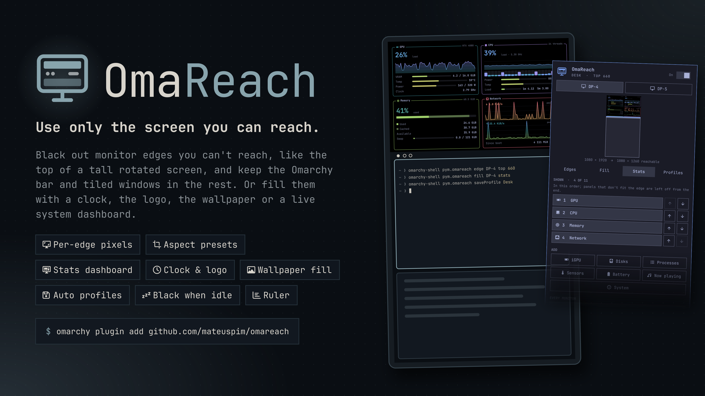
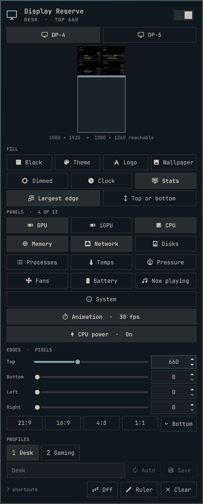
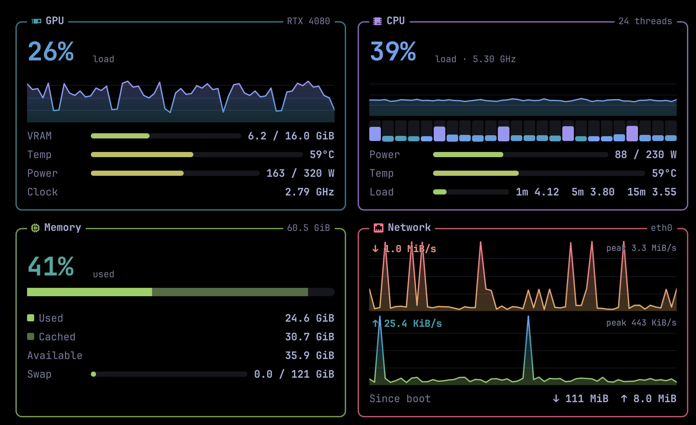

#  OmaReach



**Use only the screen you can reach.** OmaReach blacks out monitor edges you
can't reach (the top of a tall rotated monitor, a strip behind a bezel or a
shelf) and keeps the Omarchy bar and tiled windows in the area you can. The edges can stay black, or show the theme
color, the wallpaper, the Omarchy logo, a clock or a live btop-style system
dashboard.

[Install](#install) · [Remove](#remove) · [Security](#security-and-privileges) ·
[Usage](#usage) · [IPC](#keybinds-and-scripts) · [Stats fill](#the-stats-fill) ·
[Architecture](docs/architecture.md) · [Changelog](CHANGELOG.md)

- **Any edge, in pixels:** drag an edge in a to-scale preview, type exact
  pixels, or pick an aspect preset (21:9, 16:9, 4:3, 1:1). Changes apply live,
  without editing `monitors.lua` or reloading Hyprland.
- **Fills:** black (safe on OLED), the theme color, the wallpaper slice
  (plain or dimmed), the Omarchy logo, a big blocky clock, or a live
  **stats dashboard** with 13 panels: GPU, CPU, memory, network, disks,
  temperatures, battery, now playing and more.
- **Profiles:** save every monitor under a name, apply it with `1` to `9`,
  or let it apply by itself when that set of monitors connects.
- **Fullscreen that fits:** videos and games fill the reachable area instead
  of being cropped by the black edge.
- **OLED care and calibration:** black when idle, fills that move against
  burn-in, and a ruler to find exactly where the reachable area starts.

Requires Omarchy 4 with its Quickshell bar and shell plugins (tested on
4.0.4 with Hyprland 0.56).

## Quick start

1. Install and enable it:
   `omarchy plugin add https://github.com/mateuspim/omareach.git --enable --yes`.
2. Click the new monitor icon on the right of the bar.
3. Pick the monitor, then drag its edge in the preview (or type the pixels)
   until the bar sits where you can reach it. The **Ruler** button shows
   which pixel is the first one you can see.
4. Choose a **Fill**, and save the setup as a profile if you switch between
   several.

## Install

```bash
omarchy plugin add https://github.com/mateuspim/omareach.git --enable --yes
```

A monitor icon appears on the right of the bar. To put it elsewhere, run
`omarchy plugin enable pym.omareach --section left` (or `center`).

To update, pull the new version and restart the shell. The black edges stay
up while plugins reload, so the new version only takes over after a restart:

```bash
omarchy plugin update pym.omareach --yes && sleep 3 && omarchy restart shell
```

Keep the `sleep`: restarting while the shell is still reloading plugins can
crash the old shell on its way out. It comes back on its own, but there's no
reason to trigger it.

Optional, for the stats fill: `nvidia-smi` (from the NVIDIA driver) for an
NVIDIA GPU's panel. AMD and Intel GPUs, and everything else, are read from
`/proc` and `/sys`.

### Coming from Display Reserve

OmaReach was called Display Reserve (`pym.display-reserve`) before 1.7.0. The
rename came with a new plugin ID and settings file and no automatic
migration, so move over by hand:

```bash
omarchy plugin remove pym.display-reserve
mv ~/.config/omarchy/display-reserve.json ~/.config/omarchy/omareach.json
omarchy plugin add https://github.com/mateuspim/omareach.git --enable --yes
omarchy restart shell
```

Keybinds and scripts that call `omarchy-shell pym.display-reserve …` now call
`omarchy-shell pym.omareach …`. If you turned on **CPU power**, nothing
changes: its udev rule's file name never had the plugin's name in it.

## Remove

If you turned on **CPU power** in the stats fill, turn it off first (click
**CPU power · On** in the panel, or
`omarchy-shell pym.omareach cpuPower disable`), which removes its udev
rule. Then remove the plugin:

```bash
omarchy plugin remove pym.omareach
```

Every reserved edge goes away with it. Your saved reservations and profiles
stay on disk; to delete them too:

```bash
rm -f ~/.config/omarchy/omareach.json
```

If you removed the plugin with CPU power still on, take its rule back by
hand:

```bash
sudo rm -f /etc/udev/rules.d/70-rapl-energy.rules
sudo chmod 0400 /sys/class/powercap/*/energy_uj
```

## Security and privileges

OmaReach runs as your user inside the Omarchy shell. Loading it
installs nothing and writes only its own settings file.

- **Root, once, when you ask:** the stats fill's **CPU power** button (shown
  only on CPUs with a RAPL energy counter) opens a floating terminal running
  `cpu-power.sh`. It prints the exact commands, asks, and runs them with
  `sudo`, which asks for your password in that terminal (or `pkexec` where
  there is no sudo). Enabling writes
  `/etc/udev/rules.d/70-rapl-energy.rules` and makes
  `/sys/class/powercap/*/energy_uj` readable; disabling removes the rule and
  makes the counters root's again. The commands are fixed and take no input.
  Why the kernel keeps the counter from other users is in
  [The stats fill](#the-stats-fill).
- **Your config:** never edited. Edges are reserved with layer-shell surfaces,
  not `monitors.lua`, and Hyprland is never reloaded. The only file written
  is `~/.config/omarchy/omareach.json`.
- **Commands it runs:** `hyprctl -j clients` on fullscreen events (to fit
  fullscreen windows), `readlink` on the wallpaper link while a wallpaper fill
  shows, and, while the stats fill shows, `stats.sh` (bash builtins reading
  `/proc` and `/sys`) and `nvidia-smi`.
- **Network:** none. It downloads and runs nothing from the internet.

## Usage

Click the monitor icon in the bar to open the panel. It edits the monitor the
bar is on; use the monitor buttons (or Tab) to switch. Changes apply live.

<p align="center">
  
</p>

- **Preview**: the monitor drawn to scale, with the black edges, the
  reachable area and where the bar will sit. Drag an edge to resize it
  (hold Ctrl for 1 px precision), or scroll over it (Shift: ×10).
- **Edge rows**: a slider for quick moves and a field for exact pixels.
  While you type in a field, keys go to the field; Enter, Esc or Tab
  applies the value and returns to the shortcuts below.
- **Aspect presets** (21:9, 16:9, 4:3, 1:1): reserve the edges that leave a
  reachable area of that shape. The button after them says where the area
  goes (Top, Center or Bottom on a portrait monitor, Left, Center or Right
  on a landscape one) and starts from the edges you have. A preset only
  reserves the pair of edges it cuts; on a portrait 1080×1920 monitor,
  16:9 at the bottom reserves the top 1312 px.
- **Fill**: what the reserved edges show on this monitor. **Black** is the
  default and the right choice for OLED panels. **Theme** uses the theme's
  background color. **Wallpaper** shows the slice of your wallpaper that
  would be there, so the desktop looks like it carries on into the edge;
  **Dimmed** darkens that slice, by 60% unless you move its **Dim**
  slider (10% to 90%). **Logo** puts the Omarchy logo, in the
  theme's text color, on black: the wordmark on the top and bottom edges,
  Omarchy's icon over it on the sides. **Clock** shows a 24-hour HH:MM clock
  in big blocky digits, in the theme's accent color, on one edge: the
  largest reserved edge, or with **Top or bottom** the larger of those two
  whenever either is reserved. The monitor's other edges stay black. The
  digits are always upright and as large as the edge allows: one line on a
  wide edge, hours over minutes on a tall one. **Stats** turns the same one
  edge into a live system dashboard in the style of btop (see below).
  Right-click a fill to give it to every monitor, with this monitor's dim
  amount, clock edge and stats panels.
  Every fill except Black keeps something lit in the
  same place all day, which can burn into an OLED panel. The clock and the
  logo move a few pixels every 5 minutes to spread the wear, and so does the
  stats dashboard. While the monitor shows a fullscreen window, every edge
  goes black, except the stats dashboard, which stays up beside a game.
- **Panels** (with the Stats fill): which panels the dashboard shows. Click
  one to show or hide it; right-click to do the same on every monitor.
- **Ruler**: draws a scale from the middle of every edge of the monitor to
  its middle, over everything: a tick every 10 px, a longer one every 50
  and the distance from that edge every 100. The tick marked N is the first
  line left on screen with N px reserved, so for an edge behind a bezel or
  another monitor, reserve about the first tick you can see. Closing the
  panel hides the ruler.
- **Idle** (the moon button): every edge on every monitor goes black after
  30 s, 1 min or 5 min without input, and back on the next input, whatever
  the fill. Off by default. An app that holds off the screensaver, such as a
  video player, holds this off too.
- **Profiles**: save every monitor as it is now (edges, fill, paused or
  not) under a name, such as "Desk" or "Gaming", and apply it later with
  one click or `1` to `9`. Applying one also puts its name in the name
  field, so after tweaking it, **Update** saves the changes over it. The
  profile that matches the screen is selected, and its name shows in the
  panel's title. Right-click a profile to delete it. Applying or deleting
  one can be undone. Black when idle is not part of a profile.
  With a profile's name in the field, **Auto** ties it to the monitors
  connected now: whenever exactly those monitors connect, such as when you
  dock, the profile applies by itself. One profile per set of monitors. A
  shell restart with the same monitors leaves your edits alone.
- **Switch**: pauses a monitor's reservation without forgetting the values.
  Right-clicking the bar icon does the same for the bar's monitor.
- **Clear**: removes every reserved edge on the monitor. Right after a
  Clear, or zeroing an edge, the button turns into **Undo**.

Values are in logical pixels. On a scaled monitor the panel shows the scale
next to the edges, since a ruler on the screen measures something else.

| Key | Action |
| --- | --- |
| `j` / `k`, ↓ / ↑ | Select an edge |
| `h` / `l`, ← / → | Shrink or grow it by 10 px (Shift: 100, Ctrl: 1) |
| `0`, Backspace, Delete | Zero the selected edge |
| `u`, Ctrl+Z | Undo a Clear, a zeroed edge, a preset or a profile change |
| Space, `p` | Pause or resume the monitor |
| `f` | Next fill |
| `c` | Clock or stats on the largest edge / top or bottom |
| `a` | Move the reachable area of an aspect preset |
| `r` | Show or hide the ruler |
| `i` | Black when idle: off, 30 s, 1 min, 5 min |
| `1` – `9` | Apply a profile |
| `s` | Name a profile to save (Enter saves it) |
| Tab / Shift+Tab | Next or previous monitor |
| `?` | Show or hide these shortcuts in the panel |
| Esc, `q` | Close (Esc closes the shortcut sheet first) |

Opposite edges share a budget: together, top and bottom (or left and right)
can reserve at most 90% of the screen, so the bar and the panel always have
room. Values over the budget, for example from a hand edit or after a
monitor switches to a smaller mode, are trimmed when drawn.

## Keybinds and scripts

The shell answers IPC calls on the target `pym.omareach`, through
`omarchy-shell`. For the calls that take one, the first argument names the monitor: a connector such as
`DP-4`, `""` or `focused` for the focused monitor, or `all`.

| Call | Does |
| --- | --- |
| `status` | Every monitor's settings, as JSON |
| `toggle <monitor>` | Pause or resume |
| `pause <monitor>`, `resume <monitor>` | Pause, resume |
| `fill <monitor> <fill>` | Set the fill: `black`, `theme`, `logo`, `wallpaper`, `dim`, `clock` or `stats` |
| `panels <monitor> <list>` | The stats panels, as a comma list such as `gpu,cpu,memory`, or `all` or `none` |
| `panel <monitor> <panel> <on\|off\|"">` | Show or hide one stats panel; `""` switches it over |
| `nextFill <monitor>` | Next fill, as `f` in the panel |
| `dim <monitor> <percent>` | How dark the dimmed fill is, 10 to 90 |
| `edge <monitor> <side> <pixels>` | Reserve `pixels` on `top`, `bottom`, `left` or `right` |
| `aspect <monitor> <ratio> <place>` | An aspect preset: `16:9`, `4:3`, any `w:h`; `top`, `left`, `center`, `bottom`, `right`, or `""` to keep the current place |
| `ruler <monitor>` | Show or hide the ruler |
| `idle <seconds>` | Black when idle after `seconds`; `0` turns it off |
| `pace <fps>` | Frames a second the dashboard's graphs and meters move at, up to 240; `0` the display's rate, `1` no animation |
| `cpuPower <status\|enable\|disable>` | Whether the CPU's power draw can be read (`none`, `locked` or `on`); `enable` and `disable` open a terminal that shows the root commands and asks first |
| `profile <name>` | Apply a profile to every monitor |
| `saveProfile <name>` | Save every monitor as profile `name`, replacing one of that name |
| `deleteProfile <name>` | Delete a profile |
| `autoProfile <name> <on\|off>` | Apply a profile by itself whenever the monitors connected now connect, or stop |
| `profiles` | List the profiles, the one on screen marked `*` |

For example, from a terminal:

```bash
omarchy-shell pym.omareach fill DP-4 clock
omarchy-shell pym.omareach fill DP-4 stats
omarchy-shell pym.omareach panels DP-4 gpu,cpu,processes
omarchy-shell pym.omareach aspect DP-4 16:9 bottom
omarchy-shell pym.omareach profile Gaming
```

Profile names are matched ignoring case.

To pause the focused monitor with Super+Alt+P and cycle its fill with
Super+Alt+Shift+P, add to `~/.config/hypr/bindings.lua`:

```lua
o.bind("SUPER + ALT + P", "Pause OmaReach", "omarchy-shell pym.omareach toggle focused")
o.bind("SUPER + ALT + SHIFT + P", "Next reserve fill", "omarchy-shell pym.omareach nextFill focused")
```

## How it works

Each reserved edge gets two layer-shell surfaces:

| Surface | Layer | Purpose |
| --- | --- | --- |
| `pym-omareach-spacer` | Bottom | Reserves the edge with an exclusive zone. Hyprland lays out exclusive zones from the lowest layer up, so this claims the edge before the Top-layer bar, which lands just inside the reachable area with tiled windows after it. |
| `pym-omareach` | Overlay | A strip in the monitor's fill that blocks the pointer and covers anything that strays into the reserved area. |

While the ruler is up, a click-through `pym-omareach-ruler` surface
covers its monitor on the Overlay layer.

Fullscreen windows ignore exclusive zones, so on a monitor with a reserve
the plugin fits them to the reachable area instead: when a window goes
fullscreen there, it switches it to Hyprland's fullscreen state `1 2`,
maximized for Hyprland (which keeps it inside the reserve) and still
fullscreen for the app, the way a browser's fullscreen fills only its
window. Leaving fullscreen works as usual (`Super+F`, Esc, the app's own
button). A game in fullscreen gets the reachable area's size too.

The wallpaper and dimmed fills draw the image that
`~/.local/state/omarchy/current/background` points to, scaled and cropped
the way Omarchy's background layer does it. While any monitor uses one of
them, the link is checked every 2 seconds, so after a wallpaper or theme
change the edges can show the old image for up to 2 seconds.

The plugin never edits `~/.config/hypr/monitors.lua` or runs
`hyprctl reload`.

### Saved settings

Reservations are stored in `~/.config/omarchy/omareach.json`, keyed
by the monitor's Hyprland description (make, model and serial, as in
`hyprctl monitors`), so they follow the monitor when a dock renumbers its
connectors:

```json
{ "outputs": { "Dell Inc. DELL U2720Q 1A2B3C4": { "enabled": true, "top": 350, "bottom": 0, "left": 0, "right": 0 } } }
```

A monitor with no description, or one that shares its description with
another connected monitor, is keyed by its connector name (`DP-4`) instead.
Each entry also has `enabled`, which is `false` while the monitor is paused,
and can have `fill`: `"black"` (the default), `"theme"`, `"wallpaper"`,
`"dim"`, `"logo"`, `"clock"` or `"stats"`, `clockEdge`: `"largest"` (the
default) or `"topBottom"`, `dim`: the dimmed fill's percent (60 by
default), and `panels`: the stats panels, `["gpu", "cpu", "memory",
"network"]` by default.
Clear keeps the fill. Black when idle is one setting for every monitor,
stored beside `outputs` as `"idleBlack"`: seconds, left out while it is
off. The dashboard's animation pace is one setting too, `"statsPace"`:
frames a second, left out at the default 30. Profiles are stored beside them as `"profiles"`, each a copy of
`outputs` under its name; applying one makes `outputs` exactly that copy.
`"autoProfiles"` maps a profile's name to the monitor keys it applies with,
and `"monitors"` holds the keys connected last, so the plugin can tell a
new set of monitors from a restart.

The file is watched, so hand edits apply right away. An edit made within
200 ms of a change in the panel is overwritten by that change.

## The stats fill

<p align="center">
  
</p>

The Stats fill shows live system numbers on one edge, as rounded boxes
with history graphs and meters:

| Panel | Shows | From |
| --- | --- | --- |
| GPU | The discrete GPU: load, video memory, temperature, power against its limit, clock, fan, video encode/decode while busy | `nvidia-smi` for NVIDIA, sysfs for AMD and Intel |
| iGPU | The integrated GPU beside it, read the same way | sysfs |
| CPU | Load and clock with a bar per thread, power draw against the CPU's limit, temperature, load average | `/proc/stat`, the CPU's hwmon sensor, RAPL, cpufreq |
| Memory | Used, available, cached, swap | `/proc/meminfo` |
| Network | Download and upload graphs, totals, on the interface of the default route | `/proc/net/dev`, `/proc/net/route` |
| Disks | Read and write per disk, NVMe temperatures | `/proc/diskstats`, NVMe hwmon |
| Processes | The busiest programs by CPU, processes of one name added up, and the apps using the most video memory | `/proc/<pid>/stat`, `nvidia-smi` |
| Temperatures | The CPU and its dies, the GPUs, NVMe drives and memory modules | hwmon, sysfs, `nvidia-smi` |
| Pressure | How much of the last 10 s tasks stalled waiting for CPU, memory or I/O | `/proc/pressure` |
| Fans | The GPU's fan with its history, and every fan sensor | hwmon, `nvidia-smi` |
| Battery | A laptop's battery with the time left, and peripherals' such as a wireless mouse or Bluetooth headphones | `/sys/class/power_supply`, the shell's UPower devices |
| Now playing | The track playing, with its cover and progress | the shell's MPRIS players |
| System | Like fastfetch: Omarchy's icon beside the uptime, OS, Omarchy version and update channel, host, kernel, CPU, GPUs, memory, packages, shell, desktop, theme, load and threads | `/proc`, `/sys`, `/etc/os-release`, pacman's database |

GPU, CPU, Memory and Network are on by default. Each card shows what fits
its size: a small one keeps its headline and the first rows, never half
of one, and a bigger one adds rows (a GPU's fan and encoder, more
temperatures, processes and system facts). Meters too narrow to read
are left out, and a narrow Disks card leaves the temperatures to the
Temperatures panel. The panels tile the edge
in the grid that gives them the most room, and the text shrinks for a
crowded one; panels that still do not fit are left off from the end of
the list above.

The GPU panel shows the discrete GPU (NVIDIA first), and the iGPU panel the
integrated one beside it; on a machine with only one GPU, that one is the
GPU panel's. AMD GPUs report everything nvidia-smi does except video
encode/decode; an AMD GPU whose memory has a vendor is discrete, and one
without, an APU whatever memory it sets aside, is integrated. Intel GPUs report no
load, so it is worked out from how long the GPU sat idle, and only the
clock besides: their temperature and power are the CPU's. A GPU the
kernel has put to sleep, such as a laptop's discrete one, shows as asleep
and is not read, since reading it would wake it. Reading an awake GPU
also keeps it awake, so a discrete GPU that can power itself down (runtime
power management on, as on most laptops) and has shown no load for 5
seconds rests: nvidia-smi stops, an AMD card is read every 10 seconds
instead of every second, and the panel shows its last reading as idle
until a reading finds it busy again.

The CPU's power draw comes from its RAPL energy counter (Intel, and AMD
since Zen), which the kernel lets only root read; once it can, the CPU
panel lists it first ("Power 85 / 162 W", with the clock
moving up beside the load), its meter blue through green and yellow to
red as it nears the CPU's power limit: Intel's own (PL1), or an
AMD desktop's stock PPT, looked up by model since AMD keeps it in
firmware. A laptop's or unlisted model's watts show without a meter. The panel's **CPU power · Enable** button,
shown only where there is such a counter, opens a floating terminal that
prints the root commands it would run, asks, and runs them with
`sudo`, which asks for the password right there (or `pkexec` where there
is no sudo): a udev rule that lets everyone read the counter from boot on,
as btop's docs suggest, and a `chmod` that opens it now. Once on, the
button reads **CPU power · On**, and clicking it takes both back the same
way. By hand:

```bash
echo 'SUBSYSTEM=="powercap", ACTION=="add", RUN+="/bin/chmod a+r /sys%p/energy_uj"' |
  sudo tee /etc/udev/rules.d/70-rapl-energy.rules
sudo chmod a+r /sys/class/powercap/*/energy_uj
```

The counter is root's because watching it closely enough can leak what
another program computes (Platypus, CVE-2020-8694); a desktop with one
user gives little away.

The colors come from the theme's `colors.toml`, the way Omarchy's btop
themes are built: each box has its own hue, and graphs and meters run
from cool to hot (CPU cyan, blue, magenta; temperature green, yellow,
red). Omarchy reads that file at startup and sends theme switches to the
shell over IPC, so the plugin reads it again whenever the shell's theme
colors change, and the dashboard follows a theme switch at once.

The numbers come from `stats.sh`, which prints them once a second using
shell builtins only, so it starts no process per sample, and from one
`nvidia-smi` that keeps running and prints a line a second. Process
lists come every 3 seconds and only while the Processes panel is shown.
Nothing runs unless a monitor shows the Stats fill (or the panel shows
it in its preview), and everything stops while the session is idle.
Logitech Bolt receivers are not supported by the kernel's Logitech
driver, so a mouse or keyboard on one reports no battery (Solaar reads it
directly; the panel does not).
NVMe temperatures and Dell laptops' fans, which are read through the
firmware and stall the CPU for a moment, are read every 5 seconds.

The graphs scroll and the meters ease between samples at 30 frames a
second by default, and the dashboard redraws only as often. The
Animation button under the panels (or `pace`) sets it for every monitor:
the display's own rate for the smoothest motion, 60, 30 or 15 fps, or no
animation, which redraws once a second.

## Known limitations

- Omarchy's own popouts (clock, audio and others) assume the bar sits at the
  screen edge, so on a monitor with a reserved edge on the bar's side they
  open inside the black strip. This plugin's own panel opens beside the bar.

## Documentation

- [Architecture](docs/architecture.md): the components and how data flows
  between them.
- [Decision records](docs/adr/README.md): why it works the way it does.
- [Changelog](CHANGELOG.md).

## Development

```bash
npm test                     # Node tests for Model.js, Stats.js, stats.sh and cpu-power.sh
omarchy plugin validate .    # the manifest, as the marketplace checks it
```

The installed plugin, `~/.config/omarchy/plugins/pym.omareach`, is a
git checkout of this repository: check out a branch there (or pull one into
it) and restart the shell to try it. [AGENTS.md](AGENTS.md) has the conventions, and how to render the
fills and the panel offscreen.
