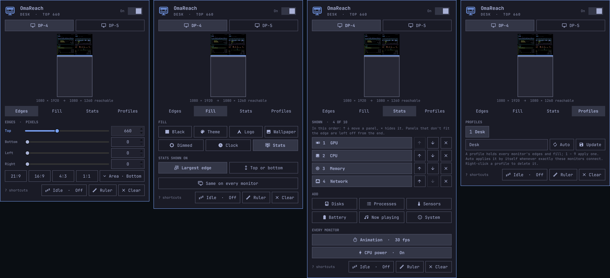

# The panel

The panel is where you set each monitor's reserved edges, live.

Click the monitor icon in the bar to open the panel. It edits the monitor the
bar is on; use the monitor buttons (or Tab) to switch. Changes apply live.

  

The header, the monitor buttons and the preview stay at the top; below
them, one page at a time:

| Page | What it sets | Described in |
| --- | --- | --- |
| **Edges** | Each edge in pixels, and the aspect presets | below |
| **Fill** | What the edges show, the dim amount, which edge the clock or the stats go on | [Fills](fills.md) |
| **Stats** | The dashboard's panels and their order, its animation and CPU power | [The stats fill](stats-fill.md) |
| **Profiles** | Named snapshots of every monitor | [Profiles](profiles.md) |

Click a tab or press `[` and `]` to switch pages; the edge keys bring up
Edges. The panel opens on the page it was left on. On a screen too short
for a page, the panel scrolls.

  

- **Preview**: the monitor drawn to scale, with the black edges, the
  reachable area and where the bar will sit. Drag an edge to resize it
  (hold Ctrl for 1 px precision), or scroll over it (Shift: ×10).
- **Edge rows**: a slider for quick moves and a field for exact pixels.
  While you type in a field, keys go to the field; Enter, Esc or Tab
  applies the value and returns to the shortcuts below.
- **Aspect presets** (21:9, 16:9, 4:3, 1:1): reserve the edges that leave a
  reachable area of that shape. The **Area** button after them says where
  the area goes (Top, Center or Bottom on a portrait monitor, Left, Center
  or Right on a landscape one) and starts from the edges you have. A preset only
  reserves the pair of edges it cuts; on a portrait 1080×1920 monitor,
  16:9 at the bottom reserves the top 1312 px.
- **Ruler**: draws a scale from the middle of every edge of the monitor to
  its middle, over everything: a tick every 10 px, a longer one every 50
  and the distance from that edge every 100. The tick marked N is the first
  line left on screen with N px reserved, so for an edge behind a bezel or
  another monitor, reserve about the first tick you can see. Closing the
  panel hides the ruler.
- **Switch** (top right, labelled On or Paused): pauses a monitor's
  reservation without forgetting the values. Right-clicking the bar icon
  does the same for the bar's monitor.
- **Clear**: removes every reserved edge on the monitor. Right after a
  Clear, or zeroing an edge, the button turns into **Undo**.

The **Fill** page and the **Idle** button are described in
[Fills](fills.md), the **Stats** page in [The stats fill](stats-fill.md),
and **Profiles** in [Profiles](profiles.md).

Values are in logical pixels. On a scaled monitor the panel shows the scale
next to the edges, since a ruler on the screen measures something else.

| Key | Action |
| --- | --- |
| `[` / `]` | Previous or next page |
| `j` / `k`, ↓ / ↑ | Select an edge |
| `h` / `l`, ← / → | Shrink or grow it by 10 px (Shift: 100, Ctrl: 1) |
| `0`, Backspace, Delete | Zero the selected edge |
| `u`, Ctrl+Z | Undo a Clear, a zeroed edge, a preset or a profile change |
| Space, `p` | Pause or resume the monitor |
| `f` | Next fill |
| `c` | Clock or stats on the largest edge / top or bottom |
| `a` | Move the reachable area of an aspect preset |
| `r` | Show or hide the ruler |
| `i` | Black when idle: off, 30 s, 1 min, 5 min |
| `1` – `9` | Apply a profile |
| `s` | Name a profile to save (Enter saves it) |
| Tab / Shift+Tab | Next or previous monitor |
| `?` | Show or hide these shortcuts in the panel |
| Esc, `q` | Close (Esc closes the shortcut sheet first) |

Opposite edges share a budget: together, top and bottom (or left and right)
can reserve at most 90% of the screen, so the bar and the panel always have
room. Values over the budget, for example from a hand edit or after a
monitor switches to a smaller mode, are trimmed when drawn.
